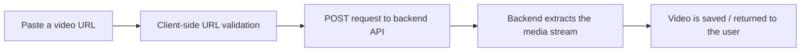

<div align="center">


# EasyFetch

**A fast, privacy-first video downloader for YouTube Shorts, Instagram Reels and X (Twitter) videos.**

[](https://nextjs.org/)
[](https://react.dev/)
[](https://www.typescriptlang.org/)
[](https://tailwindcss.com/)
[](https://easyfetch.me)

[](https://easyfetch-downloader.vercel.app)
[](https://discord.gg/dqZ9B3ASFp)
[](https://github.com/Balram-Parmar/EasyFetch/pulls)

<br />


</div>

---

## ✨ About

**EasyFetch** is a modern, no-nonsense web app for saving short-form videos from the platforms you actually use. Paste a link, hit download, done — no account, no login, no browser extensions, no clutter.

The interface is built with **Next.js 15**, **React**, **TypeScript** and **Tailwind CSS**, with a dark, gradient-driven design that works just as well on a phone as it does on a desktop.

> **This repository contains the frontend.** Video extraction and processing are handled by a separate backend service that the app talks to over HTTP.

---

## 🚀 Supported Platforms

| Platform | Content | Route | Status |
| :--- | :--- | :--- | :--- |
| 🎥 **YouTube** | Shorts (and standard video links) | `/youtube` | ✅ Live |
| 📸 **Instagram** | Reels | `/instagram` | ✅ Live |
| 🐦 **X / Twitter** | Videos | `/twitter` | ✅ Live |
| 🎵 **TikTok** | Videos | — | 🚧 In development |
| 📌 **Pinterest** | Videos | — | 🗓️ Planned |
| 🖼️ **Instagram Photos** | Images | — | 🗓️ Planned |
| ▶️ **YouTube (long-form)** | Videos | — | 🗓️ Planned |

---

## 🎯 Features

- **⚡ One-paste downloads** — the URL is parsed, validated and sent to the backend in a single step.
- **🎯 Maximum quality by default** — no confusing format tables; the best available quality is selected for you.
- **🔒 Privacy-first** — no accounts, no tracking pixels, no personal data collection.
- **📱 Fully responsive** — mobile-first layouts, large touch targets and an adaptive navigation bar.
- **🌙 Dark UI** — a polished dark theme with per-platform accent colors (red, pink, blue, emerald).
- **🔗 Smart URL validation** — platform-specific regexes accept the URL shapes people actually copy:
  - `youtube.com/shorts/...`, `youtube.com/watch?v=...`, `youtu.be/...`
  - `instagram.com/reel/...`, `instagram.com/reels/...`
  - `twitter.com/user/status/...`, `x.com/user/status/...`, `x.com/i/web/status/...`
- **🧭 SEO ready** — per-page metadata, Open Graph/Twitter images, `sitemap.xml` and `robots.txt`.
- **📊 Analytics** — lightweight Vercel Analytics integration.
- **🧩 Component library** — 40+ accessible [shadcn/ui](https://ui.shadcn.com/) + Radix primitives, ready to extend.
- **📄 Complete legal pages** — About, Contact, Privacy Policy and Terms of Service included.

---

## 🖥️ How It Works



1. **Paste** a supported URL into the input — the field also auto-submits on paste for YouTube.
2. **Validate** — the client extracts the video/reel/tweet ID and rejects unsupported links before making a request.
3. **Process** — the request is sent to the backend, with progress messages shown while it works.
4. **Download** — success and error states are surfaced inline, with automatic message clearing.

---

## 🛠️ Tech Stack

| Layer | Tools |
| :--- | :--- |
| Framework | [Next.js 15](https://nextjs.org/) (App Router) |
| UI | [React 18](https://react.dev/), [Tailwind CSS 3](https://tailwindcss.com/), [shadcn/ui](https://ui.shadcn.com/), [Radix UI](https://www.radix-ui.com/) |
| Icons | [Lucide](https://lucide.dev/), [React Icons](https://react-icons.github.io/react-icons/) |
| Language | [TypeScript 5](https://www.typescriptlang.org/) |
| Forms & validation | [React Hook Form](https://react-hook-form.com/), [Zod](https://zod.dev/) |
| Extras | [next-seo](https://github.com/garmeeh/next-seo), [next-themes](https://github.com/pacocoursey/next-themes), [Sonner](https://sonner.emilkowal.ski/), [Recharts](https://recharts.org/) |
| Analytics | [Vercel Analytics](https://vercel.com/analytics) |
| Media utilities | [ffmpeg.wasm](https://ffmpegwasm.netlify.app/), [hls.js](https://github.com/video-dev/hls.js/) |

---

## 📁 Project Structure

```text
EasyFetch/
├── app/
│   ├── (Platforms)/            # Downloader pages
│   │   ├── youtube/            # YouTube Shorts page + components
│   │   ├── instagram/          # Instagram Reels page + components
│   │   ├── twitter/            # X / Twitter page + components
│   │   └── var.tsx             # Backend API base URL
│   ├── (otherpages)/           # About, Contact, Privacy, Terms
│   ├── components/             # Header, Footer, platform selector, etc.
│   ├── data/platforms.tsx      # Platform registry (id, name, icon)
│   ├── layout.tsx              # Root layout
│   ├── page.tsx                # Homepage
│   ├── sitemap.ts              # Generated sitemap
│   └── robots.ts               # Generated robots.txt
├── components/ui/              # shadcn/ui primitives
├── hooks/                      # Custom hooks (toast)
├── lib/utils.ts                # cn() helper
├── next.config.js              # Webpack + worker-loader config
├── tailwind.config.ts
└── package.json
```

---

## 🏁 Getting Started

### Prerequisites

- **Node.js 18.18+** (required by Next.js 15)
- **npm** (or pnpm / yarn / bun)
- A running instance of the EasyFetch backend API

### Installation

```bash
# 1. Clone the repository
git clone https://github.com/Balram-Parmar/EasyFetch.git
cd EasyFetch

# 2. Install dependencies
npm install

# 3. Start the development server
npm run dev
```

Open [http://localhost:3000](http://localhost:3000) in your browser.

### Backend URL

The API base URL is defined in `app/(Platforms)/var.tsx` and defaults to
`https://backend.transends.space`. To point the app at a different backend,
set `NEXT_PUBLIC_BACKEND_URL` (for example in `.env.local`):

```env
NEXT_PUBLIC_BACKEND_URL=http://localhost:8000
```

Downloaded files are linked as `<backend>/downloads/<fileName>`, which the
backend deployment serves from its `videos/` directory.

### Available Scripts

| Command | Description |
| :--- | :--- |
| `npm run dev` | Start the development server with hot reload |
| `npm run build` | Create an optimized production build |
| `npm run start` | Serve the production build |
| `npm run lint` | Run ESLint via `next lint` |

---

## ⚠️ Disclaimer

EasyFetch is **not affiliated with, endorsed by, or sponsored by** YouTube, Google, Instagram, Meta, X, Twitter or any other platform mentioned here. All trademarks belong to their respective owners.

This tool is intended for **personal, non-commercial use only**. Please respect copyright laws and the terms of service of the platforms you use. Only download content you own or have explicit permission to download. EasyFetch does not host any copyrighted material.

---

## 📬 Contact

- 🌐 Website: [easyfetch.me](https://easyfetch.me)
- 💬 Discord: [Join the community](https://discord.gg/dqZ9B3ASFp)
- 📧 Email: [xorvfx@gmail.com](mailto:xorvfx@gmail.com)
- 🐛 Issues: [GitHub Issues](https://github.com/Balram-Parmar/EasyFetch/issues)

---

## 📄 License

No license file is currently included in this repository. All rights are reserved by the author unless stated otherwise. If you'd like to use this project, please reach out first.

---

<div align="center">

**Built with ❤️ by [Balram Parmar](https://github.com/Balram-Parmar)**

If EasyFetch saved you some time, consider giving the repo a ⭐!

</div>
